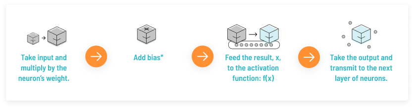
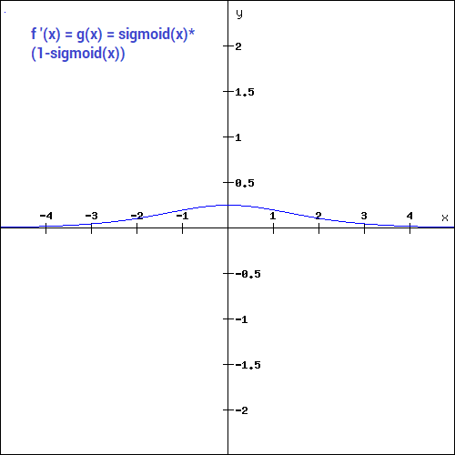

# Implement Activations

Task Description: Create a class that has a ""activate"" method for neural network and implement different activation functions (Sigmoid, Tanh, ReLu, Leaky ReLU)

# Activation Function
In ANN, as input is fed, the neurons perform a linear transformation using weight and biases.

Activation function gives a small value for small inputs, and a large value for inputs that exceed a threshold. So it can be considered as a gate that checks if the incoming value is greater than a critical number. Some interesting activation function history is available [here](https://deepai.org/machine-learning-glossary-and-terms/activation-function). They can be used to filter irrelevant data. More importantly, they add non-linearity in the neural network. So even if not using activation function makes the neural network simpler, this would be less powerful and will not be able to learn the complex patterns from the data.

**Basic process carried out by a neuron in a neural network**

*Image Source: [missinglink.ai](https://missinglink.ai/guides/neural-network-concepts/7-types-neural-network-activation-functions-right/)*

# Some Activation functions

1. Binary Step function: It simply returns 1 if the input is above threshold and 0 otherwise.
    
2. Linear Activation Function: It allows range of output depending on input. However it has two major problems:
   
   1. We can not use backpropagation to train the model as it's derivative has no relation to the input. So we cannot determine which weight gives better predictions.
   2. All layers of the neural network collapse into one. No matter the number of layers in the hidden layers, the last layer is the linear function of the first layer.
3. Non-Linear Activation Functions: They allow the model to create complex mappings between the network's input and outputs, which are essential for learning and modeling complex data like: video, images, audio and datasets which are non-linear or have high dimensionality. Unlike linear activation functions, they allow backpropagation and stacking of multiple layers of neurons to create deep neural networks.

Some non-linear activation functions are described below:

### Sigmoid/ Logistic:
The mathematical expression is:

f(x) = $`\dfrac{1}{1+\exp^{-x}}`$
    
The output of this function is between 0 and 1. The function is differentiable:

f'(x) = sigmoid(x) * (1 - sigmoid(x))
    

*Image Source: [Analytic Vidhya](https://www.analyticsvidhya.com/blog/2020/01/fundamentals-deep-learning-activation-functions-when-to-use-them/)*

As we can see here the gradient values are significant for range -3 to 3 (i.e for values beyond [-3, 3], we have small gradient) and the graph is not symmetric around zero (i.e always gives the same sign output).

**Advantages**
- Smooth gradient
- Clear prediction
 
**Disadvantage**
- Vanishing gradient: for very high or very low input values, there is almost no change to the prediction causing vanishing problems.
- Computationally expensive

### Tanh

Tanh function is symmetric around the origin and hence gives output in range [-1, 1] preventing it from having the same sign.

f(x) = $`\dfrac{2}{1+\exp^{-2x}} - 1`$

**Advantages**
- zero centered - easier to model inputs that have strongly negative, neutral, and strongly positive values.

### ReLU
The Rectified Linear Unit (ReLU) deactivates a neuron only if the output of the linear transformation is less than 0.

        f(x) = max(0, x)

As this function discards negative input values, it is far more computationally efficient compared to sigmoid and tanh.

**Advantages**
- Computationally efficient - allows the network to converge quickly

**Disadvantages**
- Dying ReLU
 
### Leaky ReLU

In ReLU, during the backpropagation process, the weights and biases for some neurons are not updated and can create dead neurons. To prevent this Leaky ReLU assigns small value times input instead of 0.

        f(x) = 0.01x, x < 0
             = x,     otherwise

## Choosing between activation function

There is no rule of thumb, however depending on the problem we can choose our activation function.

# References
1. [Activation Functions and When to Use Them?](https://www.analyticsvidhya.com/blog/2020/01/fundamentals-deep-learning-activation-functions-when-to-use-them/)
2. [7 Types of Neural Network Activation Functions: How to Choose?](https://missinglink.ai/guides/neural-network-concepts/7-types-neural-network-activation-functions-right/)
