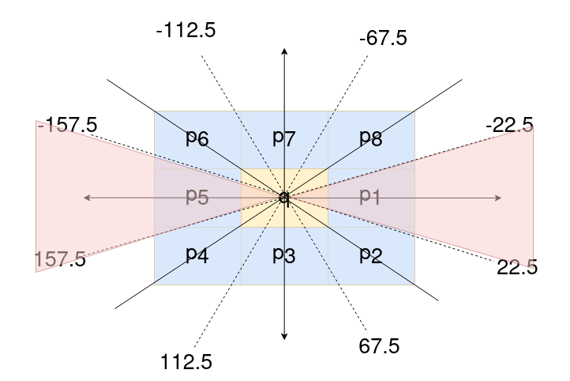
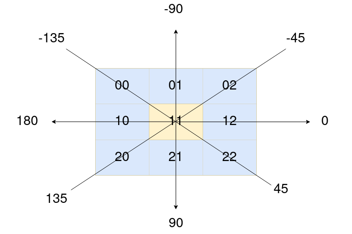
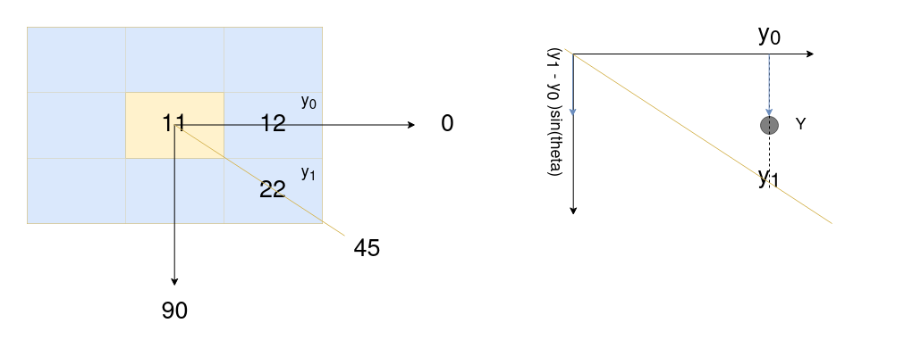
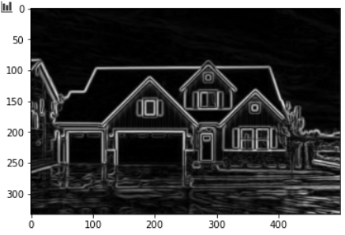
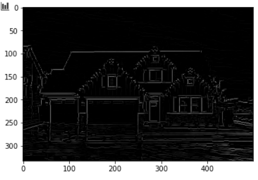
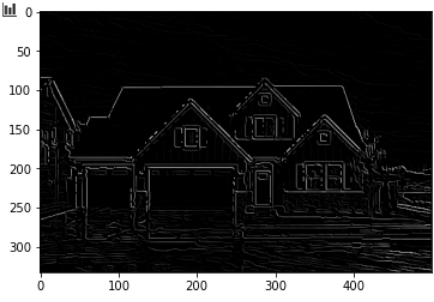
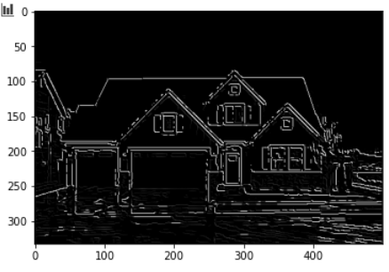

# Canny Edge Detection
Task Description: Understand and implement Canny Edge Detection Algorithm from scratch using Python

The edge of image contains rich information. Canny Edge Detector is one of the most effective edge detector whose input is the output of Sobel. In a nutshell, it finds the angle and applys threshold to the output of Sobel.

1. Apply Sobel
2. Find gradient direction
3. Apply Non-max Supression
4. Apply Double Thresholding and Hysteresis

## Solbel Filter

$`G_x`$ = 
$`\begin{bmatrix}
-1 & 0 & +1\\
-2 & 0 & +2\\
-1 & 0 & +1  
\end{bmatrix}
`$
$`* I`$

$`G_y`$ = 
$`\begin{bmatrix}
-1 & -2 & -1\\
0 & 0 & 0\\
+1 & +2 & +1  
\end{bmatrix}
`$
$`* I`$

Magnitude:

$`G = \sqrt{G_x^2 + G_y^2}`$

## Non-max supression
The Non-max supression algorithm selects high scoring and deletes close-by less confident neighbours. So, ultimately it creates thin edges from the thick edges created by Sobel Filter. 

In order to implement this we have approaches like rounding the angle and interpolation. 

### Rounding
Let q be the pixel that we are working on and $`\theta`$ be the angle. Let $`p_1`$, $`p_2, p_3, p_4, p_5, p_6, p_7`$ and $`p_8`$ be the neighbours of $`q`$ in right, right bottom, bottom, left bottom, left, left top, top and top right respectively. Then we can determine q by comparing the value with neighbour. 

For example let $`\theta = 20\degree`$, q is compared with $`p_1`$ and $`p_5`$

Then q is supressed if value at $`q`$ is less than values at $`p_1`$ and $`p_5`$.  

## Interpolation
Let us assume the following matrix. Here also we look at the gradient and determine in between which angles does the gradient lie. 

Let us suppose we are looking at a pixel value at 1,1. Let $`\theta`$ be between 0 and 45. So we get the following image. So here we have to interpolate between two points $`y_0`$ and $`y_1`$. Since Y axis is parallel to this, we find the sin component  of the difference in the pixel value. After this adding $`y_0`$ offset to the obtained value gives the pixel value ($`Y_1`$) that we are looking for. Similarly we find $`Y_2`$ on the other side (in between 180 and -135). Finally compare these values at interpolant with the value at 1,1. If value at 1,1 is smaller than both $`Y_1`$ and $`Y_2`$, then it is supressed (set to zero).

This is process is carried out in every pixel of the image.

### Double thresholding
This is simple using double threshold values and find strong, weak and non-relevant pixels. 
- Strong pixels are pixels that have an intensity so high that we are sure they contribute to the final edge.
- Weak pixels are pixels that have an intensity value that is not enough to be considered as strong ones, but yet not small enough to be considered as non-relevant for the edge detection.
- Other pixels are considered as non-relevant for the edge.

So we can seee that
- High threshold is used to identify the strong pixels (intensity higher than the high threshold)
- Low threshold is used to identify the non-relevant pixels (intensity lower than the low threshold)
- All pixels having intensity between both thresholds are flagged as weak and the Hysteresis mechanism (next step) will help us identify the ones that could be considered as strong and the ones that are considered as non-relevant.

### Edge tracking by Hysteresis
Finally we use hysteresis for edge tracking. Based on the threshold results, the hysteresis transforms weak pixels to strong ones, if and only if at least one of the pixels around the one being processed is a strong.

# Results

1. Sobel Filter

2. NMP without interpolation

3. NMP with interpolation

4. NMP after thresholding and hysteresis

# References
1. [Canny Edge](https://towardsdatascience.com/canny-edge-detection-step-by-step-in-python-computer-vision-b49c3a2d8123)
2. [Standford](http://vision.stanford.edu/teaching/cs131_fall1920/slides/04_edges.pdf)
3. [Utah](http://www.sci.utah.edu/~gerig/CS6640-F2012/Materials/Canny-Gerig-Slides-updated.pdf)
4. [Canny Edge detector ](https://github.com/JustinLiang/ComputerVisionProjects/blob/master/CannyEdgeDetector/CannyEdgeDetector.m)
5. [Justin-liang](http://justin-liang.com/tutorials/canny/)
6. [moonbook](https://moonbooks.org/Articles/How-to-convert-an-image-to-grayscale-using-python-/)
7. [Illinois](https://courses.engr.illinois.edu/cs543/sp2017/lectures/Lecture%2006%20-%20Edge%20Detection%20-%20Vision_Spring2017.pdf)
8. [A new edge detection algorithm based onCanny idea](https://aip.scitation.org/doi/pdf/10.1063/1.5005213)