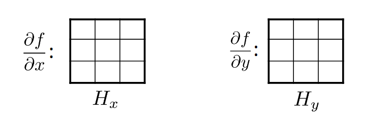
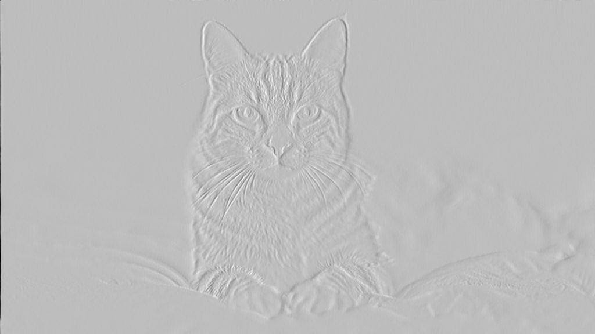
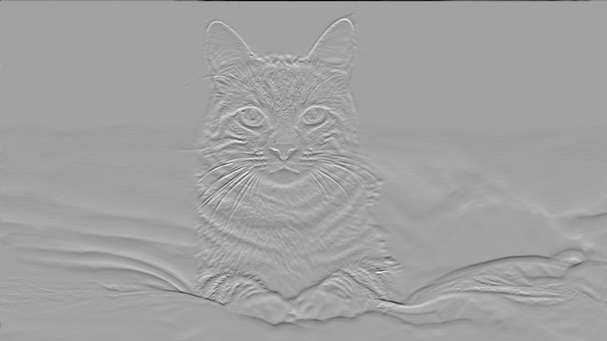
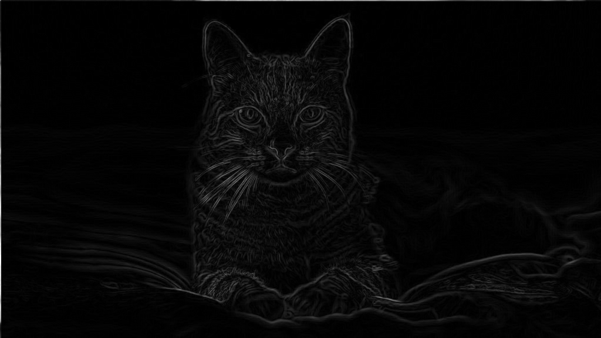

# Directional Derivative
Task description: 
1. Read a grayscale image and create two matrices by applying directional derivative on x-direction and y-direction. 
2. Add and normalize the result to display it as another grayscale image.

## Description

Mathematically, if f is a differentiable function of x and y, then f has a directional derivative in the direction of any unit vector $`\vec{u} = <a, b>`$

$`D_{\vec{u}} f(x, y) = f_x(x, y)a + f_y(x, y)b `$

## How do we differentiate a digital image F[x,y]?
Option 1: reconstruct a continuous image, f, then compute the derivative

Option 2: take discrete derivative
    $`\partial f / \partial x \approx F[x + 1, y] - F[x, y]`$

## Approach
1. Apply directional derivative $`H_x`$ along X
2. Apply directional derivative $`H_y`$ along Y

## Usage

        python src/main --image <path of image>

## Results
#### Original grayscale image
 

 #### Directional derivative in X direction
 

 #### Directional derivative in Y direction
 

 #### Added and normalized
 

## Reference
1. https://www.cs.cornell.edu/courses/cs6670/2011sp/lectures/lec02_filter.pdf
2. https://www.cs.toronto.edu/~mangas/teaching/320/slides/CSC320L05.pdf
3. https://www.usna.edu/Users/oceano/raylee/SM223/Ch14_6_Stewart(2016).pdf
4. https://tutorial.math.lamar.edu/Classes/CalcIII/DirectionalDeriv.aspx

