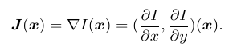
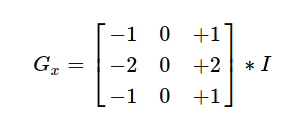
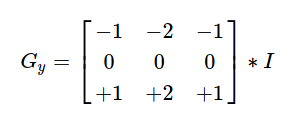
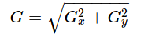
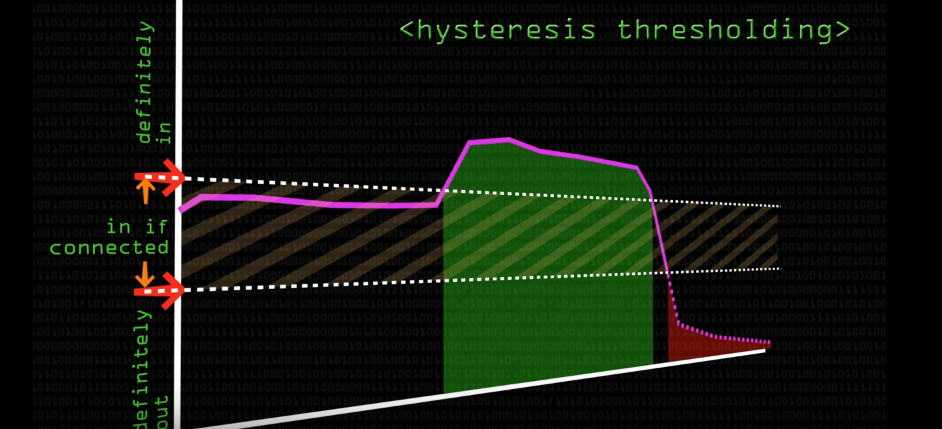
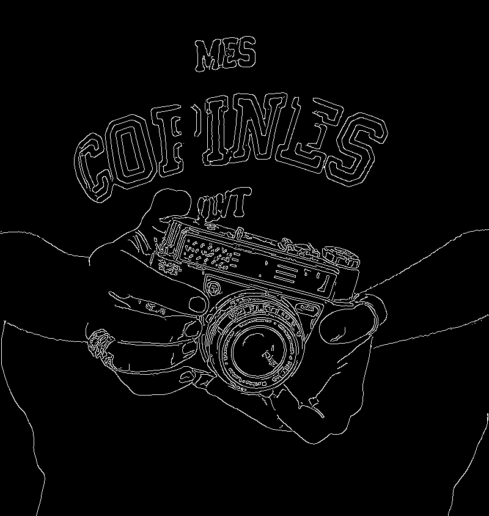

# Edge Detection

Task Definition: Understand edge detection and apply edge detection on image using C++/OpenCV

## Description
Edges are locations where there is rapid intensity varation i.e with steep slopes. Mathematically, slope and direction of a surface is defined through gradient:

Magnitude of J gives the rate of increase in particular dirction. Imagine that there is a source of heat in a room then the arrow pointing from low temp to high is the gradient. 

### Grayscale Images
There are few methods to find edges in colorful images like: combining the output of grayscale detors run on reach color band separately. However, we are using grayscale image as it will be easier to work with it.

### Blur
As we take derivative of an image high frequency accentuates and hence result in amplification of noise. So to solve this, we first apply smoothing technique (blur). Circular smoothing is used in oder to make orientation independent.

### Sobel Derivatives
Here Gaussian blur is applied and then differentiation is calculated. Sobel calculates derivatives horizontally and vertically- horizontally to detect horizontal intensity change and vertically to detect vertical intensity changes. 

Finally combining them gives the gradient.

### Canny Edge Detector
Canny Edge Detector is one of the most effective edge detector whose input is the output of Sobel. In a nutshell, it finds the angle and applys threshold to the output of Sobel.

1. Apply Sobel
2. Find gradient direction
3. Applies Hysteresis

### Thresholding
It is useful for image segmentation. Here we compare the pixel intensity in image with respect to a threshold.

#### Hysteresis
It is nothing but a two level threshold - upper and lower. Here a pixel gradient above upper threshold are accepted automatically and those below lower are rejected. For those in between are accepted if they are connected to the ones above the upper threshold. Recommended upper:lower ratio id 2:1 or 3:1

#### Zero crossing
Zero crossing is a point where sign of function changes. We can consider it as a thresholding for Laplacian filter. 

### Usage
1. Object recognition
2. Image editing
3. Styling image

## Approach
Most of my time went on studies the theories of edge detection. In order to apply Edge detection, firtly the image was grayscled and then blurred so as to remove noise using `cv::blur()`. Then, `cv::Canny()` was used with 2:1 upper to lower thresholding. 

## Results

## Resources
1. Richard Szeliski - Computer Vision_ Algorithms and Applications(2011)
2. OpenCV documentation
3. ["Computer phile"](https://www.youtube.com/watch?v=sRFM5IEqR2w&list=PLZf3ikppKeu0BVjTk3AT53hWheijiqC8Y&index=13)

