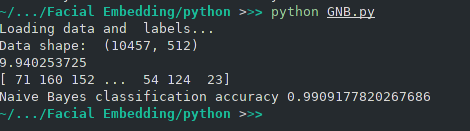
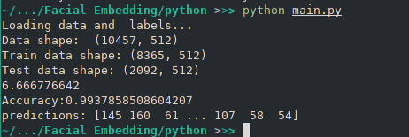

# Facial Embedding using GNB
Task Description: Build Facial Embedding Classifier using Gaussian Naive Bayes classifier (From Scratch)

## Naive Bayes
Bayes' Theorem provides a way to calculate the probability of a piece of data belonging to a given class, given our prior knowledge. Bayes' Theorem:

$`P(class|data) = \dfrac{P(data|class) * P(class)}{P(data)}`$

Algorithm
1. Separate the data by class and find the mean and variance of x in each class
2. calculate probability using probability density function
3. Get class probability
4. get final prediction

Approach

1. I first studied about Gaussian Naive Bayes and implemented it in python using probability distribution:

    $`p(x|C_k) = \dfrac{1}{\sqrt{2\pi\sigma_k^2}} \exp^{\dfrac{(x - \mu_k)^2}{2\sigma_k^2}}`$

The result thus obtained has 99 accuracy and took about 10s.

2. The I looked into discriminant function for Gaussian Density and used it.

$`p(x|C_k) = \dfrac{1}{\sqrt{2\pi\sigma_k^2}} \exp^{\dfrac{(x - \mu_k)^2}{2\sigma_k^2}}`$

breaking down into:

$`-\dfrac{n}{2} log(2\pi) - \dfrac{1}{2}log(\sigma) - \dfrac{(x - \mu)^2}{2\sigma}`$

The result was 99.3 accuracy and took about 6s.

3. Finally I tried implementing in C++.

## Usage

        $ python src/main.py

        $ python src/GNB.py

change directory to build
        
        $ make
        $ ./FacialEmbedding

## Results

# Resources:

1. [Discriminant_Functions_For_The_Normal](https://www.projectrhea.org/rhea/index.php/Discriminant_Functions_For_The_Normal(Gaussian)_Density)
2. [Normal Distribution](https://en.wikipedia.org/wiki/Normal_distribution)

3. [Optimized Naive-Bayes and Decision Tree Approaches for fMRI Smoking Cessation Classification](https://www.hindawi.com/journals/complexity/2018/2740817/)

4. [Naive_Bayes_classifier](https://en.wikipedia.org/wiki/Naive_Bayes_classifier#Gaussian_na%C3%AFve_Bayes)
5. [ML_Algo_CPP](https://github.com/ahmhashesh/ML_Algo_CPP)
6. [Discriminant Analysis](https://online.stat.psu.edu/stat508/book/export/html/645)
