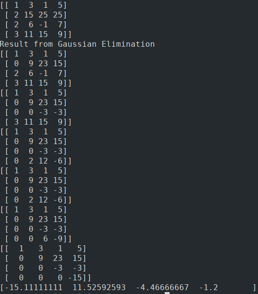

# Implementing Gaussian Elimination
Task Description: Implement gaussian elimination method to solve linear equations of 4 variable using numpy

Gaussian Elimination technique solves a system of linear equations of any size. The operations of the Gaussian elimination method are:
1. Interchange any two equations.
2. Replace an equation by a nonzero constant multiple of itself.
3. Replace an equation by the sum of that equation and a constant multiple of any other equation.

With these operations, a matrix can be transformed into an upper triangular matrix. The number of arithmetic operations required to perform row reduction can be used to measure the algorithm's computational efficiency. For example, to solve a system of n equations for n unknowns by performing row operations on the matrix until it is in echelon form, and then solving for each unknown in reverse order, requires n(n + 1)/2 divisions, (2n3 + 3n2 − 5n)/6 multiplications, and (2n3 + 3n2 − 5n)/6 subtractions, for a total of approximately 2n3/3 operations. Thus it has arithmetic complexity of O(n3).[3](https://en.wikipedia.org/wiki/Gaussian_elimination)

### Applications
1. Find inverse
2. Compute determinants
3. Compute ranks and bases

Example:

x + 3y − 5z=  2 \
3x + 11y − 9z=  4 \
−x + y + 6z=  5

x + 2y + 3z = 2 \
    2y + 6z = -2 \
    4y + z = 7

x + 2y + 3z = 2 \
     2y + 6z = -2 \
          -11z = 11

using backward substitution,
z = -1,
y = 2,
x = -9

## Approach

Naive Gaussian Elimination: Here I implemented Gaussian elimination in which rows never re-orders. This fails in case of `zero pivot`.

Gaussian Elimination: Here I implemented Gaussian where the `exchange` of current row takes place with the row having `maximum` absolute value. Choosing the `largest possible absolute value` of the pivot improves the `numerical stability` of the algorithm, when `floating point` is used for representing numbers.

## Result
The program successfully finds the solution.

# References
1. [Lboro.ac.uk](https://learn.lboro.ac.uk/archive/olmp/olmp_resources/pages/workbooks_1_50_jan2008/Workbook30/30_2_gauss_elim.pdf)
3. [Wikipedia](https://en.wikipedia.org/wiki/Gaussian_elimination)
  

