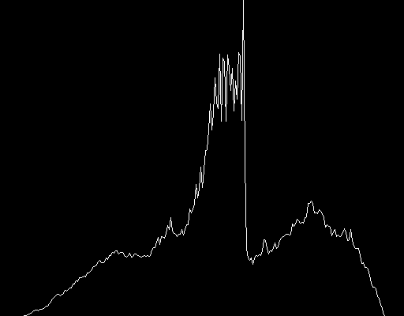
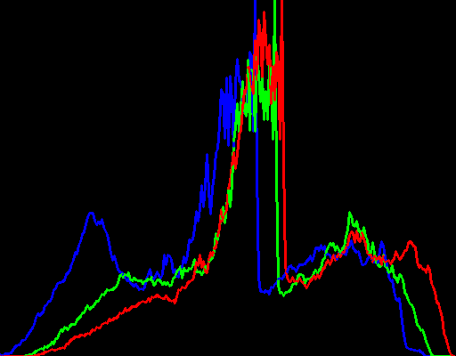

# Creating Histogram

### Color Channels
Pixels are the building block of image. Color channel stores color information (pixel value) for color components in an image.  

**RGB**: RGB has three channels: Red, Green,and Blue. If we have a 24-bit RGB image, it will have an 8-bit channel each. So each pixel in a colorful image has three columns of RGB value. Also we need to note that in opencv, colors are stored in BGR format.  

**CMYK**: This has four channels: cyan, magenta, yellow, and black. So a 32-bit CMYK image has four-cyan, magenta, yellow, and black 8-bit channels.

## Histogram
Histograms basically plots the frequency of each intensity value in an image i.e the number of times each intensity value repeated over the entire image. However, it does not give the location of that intensity and hence we cannot reconstruct the image from histogram alone.

Suppose we have a 8-bit grayscale image, then there will be 256 different possible intensities. And the histogram of this image will have higher frequency towards right if the image has a bright part and towards left if the image has a darker part.  

##### Parts
1. dims: Number of parameters to collect data of
2. bins: Number of subdivisions in each dim
3. range: Limits for the values to be measured.

Usages:
- convert Grayscale image to binary and separate background
- equalization of brightness and contrast in image

### Approach

In order to create a gray-scale histogram of an image it was converted to gray-scale with the `cv::cvtColor()` function. After that number of each intensity was calculated with `cv::calcHist()`. Finally for each intensity value, a line was drawn.

In order to create a color histogram a similar approach was taken. The color was splitted and a line was drawn for each splitted color.

### Result

### Resources:

- [OpenCV Docs](https://docs.opencv.org/master/d8/dbc/tutorial_histogram_calculation.html)
- [ed.ac.uk](https://homepages.inf.ed.ac.uk/rbf/HIPR2/histgram.htm)
- [cs.wpi.edu](https://web.cs.wpi.edu/~emmanuel/courses/cs545/S14/slides/lecture02.pdf)
