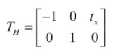
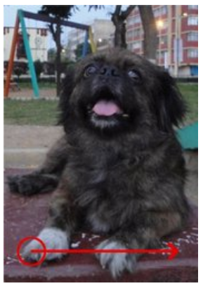
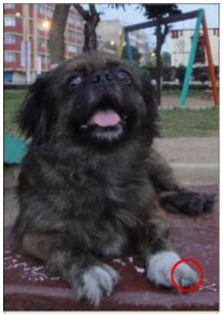
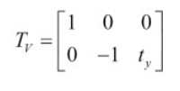
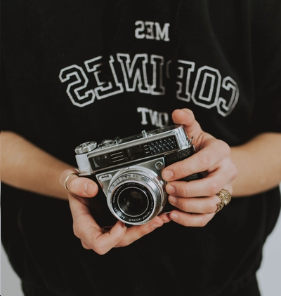
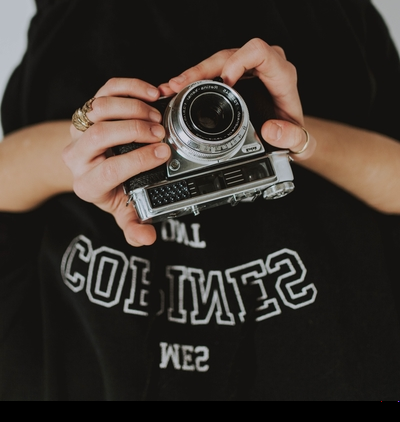

# Image Flipping
Task Description: Read Image and apply horizontal and vertical flipping of image from scratch

## Description
### Geometric Transformation
Geometric transformation deforms the images while preserving the image content.

#### Reflection
Reflection is the transformation of a point that makes it like a mirror image of that point.For example reflection of W about X axis will result in M.

#### Reflection about Y-axis
An object can be reflected about X-axis with:
A(x,y) = A'(-x, y)

Similarly, reflection matrix can be used:

In the case of images as we are remapping the pixel point from h(x,y) to h'(No of Image Columns - x, y). This is flip in X direction. That is to the other side as shown in example below:

Here we can see how the circle has been mapped to the other side of an image.
#### Reflection about X-axis
An object can be reflected about X-axis with:
A(x,y) = A'(x, -y)

Similarly, reflection matrix can be used:

## Approach

As images are collections of pixels stored in matrix form, so in order to flip an image we need to remap the position of the pixel from one side to another depending on what we want to achieve. So the simple method would be to perform a nested `for` loop over the given matrix of image and assign the pixels of position (No of Image COlumns - x, y) or (x, No of Image Rows - y).

## Problem

Few problems encountered were:
1. Image being translated quite away from the main window leaving only some part of the image after reflection.
2. Implementing other scanning methods like C method and Iterator method.

## Results
The results thus obtained are:

a. vertical flip

b. horizontal flip

## Analysis

In order to flip the image here I have used nested for loop which has time complexity of O(n^2). I think we can improve this by other methods like using an iterator if that's applicable here.

## Resources
1. OpenCV documentations
2. [Learning Image Processing with OpenCV]( https://storage.ey.md/Technology%20Related/PDFs%20and%20Books/Learning%20Image%20Processing%20with%20OpenCV%20by%20Gloria%20Bueno%20Garcia%20-%202015.pdf )

