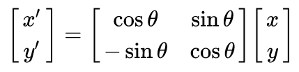
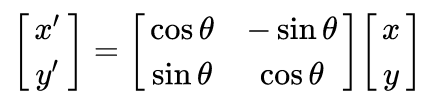
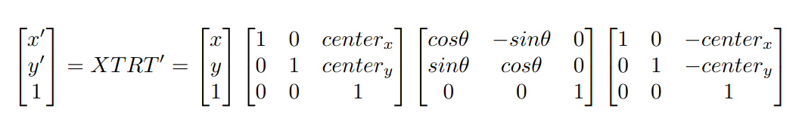
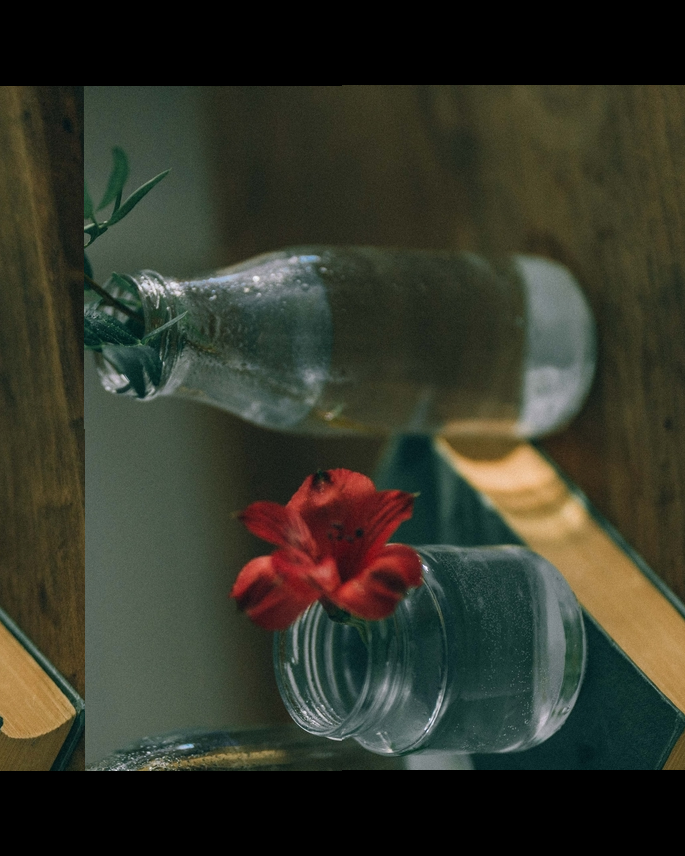
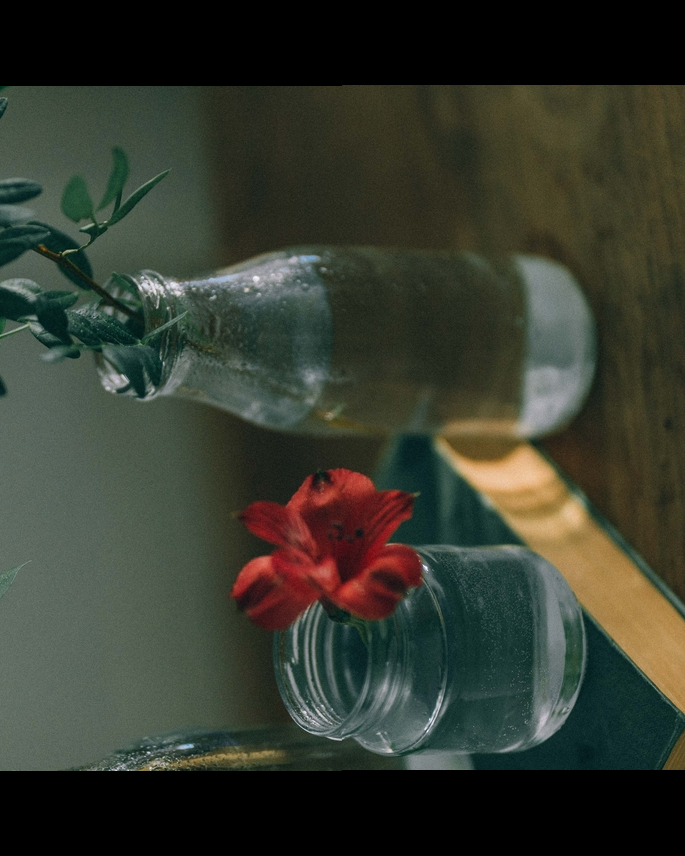

# Image Rotation
Task Description: Read image and rotate the image by an angle input by user (Use scratch mathematical approach on matrix operation)

## Description
### Geometric Transformation
Geometric transformation deform the images while preserving the image content.

#### Affine Teransformation
An affine transformation preserves distance ratio from each point of a line to the other end. Some affine transformations are: scaling, rotaion, and reflection. 

#### Rotation
In rotation we are trying to move a point in a circular way about it's center. Here we rotate any point about origin. To rotate a point by an angle theta clockwise about the origin we have rotation matrix:

And for counterclockwise about origin:

#### Translation
In order to rotate an object which does not have it's center at origin, we first need to translate it to origin as the rotation always rotates the entire coordinate system about origin and hence taking the image to some undesired position.

## Approach

As images are collection of pixel stored in matrix form, so in order to rotate an image we need to remap the position of the pixel from one side to another depending on what we want to achieve. In order to rotate the image we first need to bring the image center at the origin as the rotation always rotates the entire cordinate system about the origin. So we find the center of image with: `(src.cols / 2 , src.rows / 2)`. After this we translate entire image points to `(0,0)` with `(point - center_x , point - center_y)`. Now we are free to rotate the image. To rotate we use rotation matrix. After rotation we again translate the image back to it's original position.

The sequence of transformation I have used in my program is:

## Problem

Few problems encountered were:
1.  Image was rotated but not as desired.
2.  Some part of result image was overlapped by redundant pixels.

## Solution
1. Had to convert Degree to Rad : Rad = Degree * pi / 180
2. Checked if the rotated pixed point is with in 0 < x < Column size and 0 < y < Row size

## Results
The results thus obtained are:

Original Image

Result image

## Analysis

## Resources
1. OpenCV documentations
2. [Learning Image Processing with OpenCV]( https://storage.ey.md/Technology%20Related/PDFs%20and%20Books/Learning%20Image%20Processing%20with%20OpenCV%20by%20Gloria%20Bueno%20Garcia%20-%202015.pdf )
3. [Wikipedia](https://en.wikipedia.org/wiki/Transformation_matrix#Rotation)
4. [Andreageremia](http://www.andreageremia.it/tutorial_matrix_transform.html)
