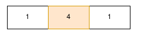
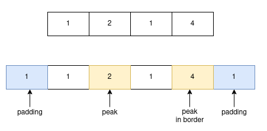

# Index of Peak (Local maxima)
Task Description: Find index of all the peaks in a 1D numpy array.

Let `arr` be a 1D numpy array. Values in arr are assigned with `numpy.random.ranint` which populates the array with `uniform integer variables`.

Peaks (`Local maxima`) are the values that is `greater` than its `neighbor elements`. For example: if our array looks like array([1,4,2]) then our peak is 4. 

## Approach 1: Travel and compare
In order to find peaks I have compare the value at $`i^{th}`$ index with $`i - 1^{th}`$ and $`i + 1^{th}`$. If greater or equal, append to index array.

## Approach 2: Scipy
Peaks can also be detected with `find_peaks` available in `scipy`. This returns the index of peaks(local maxima) in given array.

## Approach 3: Padding
Sometimes border can also be considered as peaks. Let's assume a scenario when the array is: array([1, 2, 1, 4]). Here we can consider 2 and 4 as peaks. Both approaches discussed earlier do not consider boarder elements. So, we can use `padding` to include those elements as well. Here I have added padding from `numpy.pad` with mode = `minimum`. `minimum` is used so as to consider boarder as peak if its other neighbor is smaller. However if we used `maximum` then the border would be considered peak only if borders are maximum. 

## Time Comparison
I also compared time in case of Travel and compare with scipy. Since Scipy is highly optimized, it's performance outruns Travel and compare as the size of array increases. For a array of size `1000`, Scipy took `0.002s` less time.

Array size | Travel and compare | scipy
---|---|---
10 | $`4.2 * 10^{-5}`$ | $`2.8 * 10^{-5}`$
100 | $`2.3 * 10^{-4}`$ | $`3.8 * 10^{-5}`$
1000 | $`2.1 * 10^{-3}`$ | $`5.2 * 10^{-5}`$

