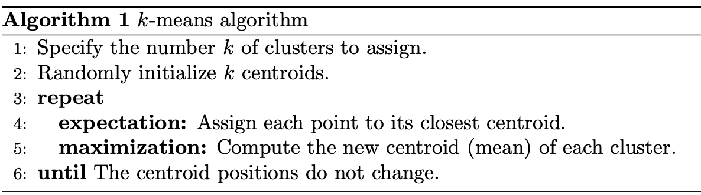
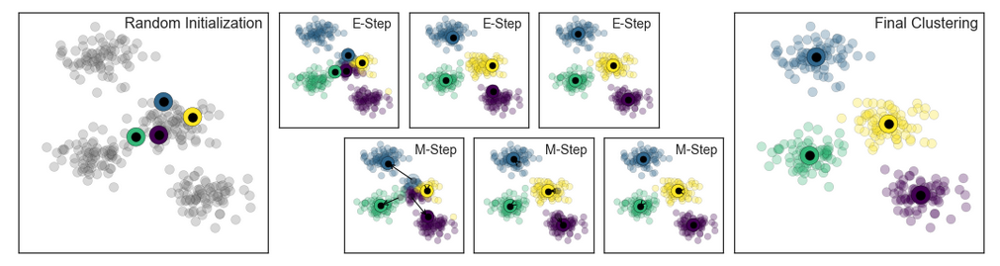
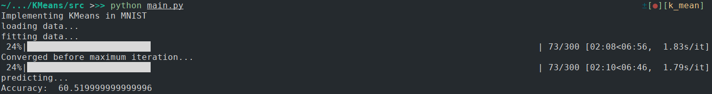
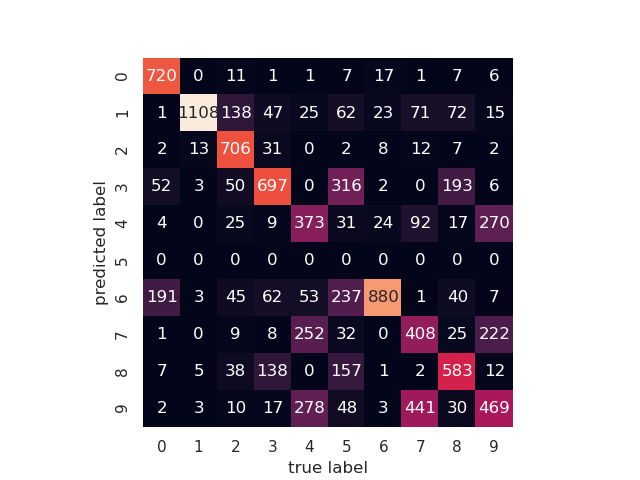

# KMeans clustering on MNIST dataset from scratch
Task : Implement k-means clustering on MNIST dataset from scratch

## Description

### MNIST dataset
The MNIST dataset of handwritten digits, from [http://yann.lecun.com/exdb/mnist/](http://yann.lecun.com/exdb/mnist/) has 60,000 training set examples and 10,000 test set examples. The image is centered in 28*28 image.
 
Images stored as Numpy arrays are 2D arrays and are reshaped to 1D to feed into KMeans algorithm by `loadloacl_mnist` from `mlxtend.data`. This give a (60000, 784) shaped numpy array. 

Important concept to remember here is: Consider each image as a vector in 784 dimensional space. So there are 60,000 vectors. 

### KMeans
KMeans is an unsupervised learning algorithm that finds clusters of data based on similarity. The only hyperparameter required is the number of clusters `k`. A point is considered to be in a particular cluster if it is closer to that cluster's centroid than any other centroid. It assigns data points to a cluster such that the sum of the squared distance between the data points and the cluster’s centroid (arithmetic mean of all the data points that belong to that cluster) is at the minimum.

Formally, k-means is the task of finding a partition $`S = {S_1, S_2, .. S_k}`$ where $`S`$ satisfies:

$`argmin \sum_{i=1}^k \sum_{x\in S_i}||x - \mu_i||^2`$

### Algorithm



[source](https://jakevdp.github.io/PythonDataScienceHandbook/06.00-figure-code.html#Expectation-Maximization)


### Evaluating k
On of the methods used to evaluate k is **Elbow method**.  Here we simply try different values of k and calculate Sum of squared error (SSE) between data points and assigned clusters' centroids. Then we pick the one where SSE starts to flatten out the forming elbow.

### Applications of clustering
1. Customer Segmentation
2. Document Clustering
3. Image Segmentation
4. Recommendation Engines
5. News Article clustering

## Approach
- First I tried to visualize KMeans algorithm on a few points which provided a good picture of how the algorithm works.
- Then I tried to understand how the algorithm works.
- Then I implemented using python.
- Then I tried to optimize the algorithm as mentioned in ***[this article](https://blog.paperspace.com/speed-up-kmeans-numpy-vectorization-broadcasting-profiling/)***
- Finally I implemented the algorithm with classes with reference from [here](https://towardsdatascience.com/k-means-clustering-algorithm-applications-evaluation-methods-and-drawbacks-aa03e644b48a)

## Dependencies
```
    1. numpy
    2. mlxtend
    3. scipy
```
## Usage

        $ python src/main.py 

## Results




## References
1. [https://blog.paperspace.com/speed-up-kmeans-numpy-vectorization-broadcasting-profiling/](https://blog.paperspace.com/speed-up-kmeans-numpy-vectorization-broadcasting-profiling/)
2. [https://www-users.cs.umn.edu/~kumar001/dmbook/ch8.pdf](https://www-users.cs.umn.edu/~kumar001/dmbook/ch8.pdf)
3. [https://towardsdatascience.com/k-means-clustering-algorithm-applications-evaluation-methods-and-drawbacks-aa03e644b48a](https://towardsdatascience.com/k-means-clustering-algorithm-applications-evaluation-methods-and-drawbacks-aa03e644b48a)
4. [https://reasonabledeviations.com/2019/10/02/k-means-in-cpp/](https://reasonabledeviations.com/2019/10/02/k-means-in-cpp/)
5. [https://mubaris.com/posts/kmeans-clustering/](https://mubaris.com/posts/kmeans-clustering/)
6. [https://scikit-learn.org/stable/auto_examples/cluster/plot_kmeans_digits.html](https://scikit-learn.org/stable/auto_examples/cluster/plot_kmeans_digits.html)
7. [https://johnloeber.com/docs/kmeans.html](https://johnloeber.com/docs/kmeans.html)
8. [https://jakevdp.github.io/PythonDataScienceHandbook/05.11-k-means.html](https://jakevdp.github.io/PythonDataScienceHandbook/05.11-k-means.html)
