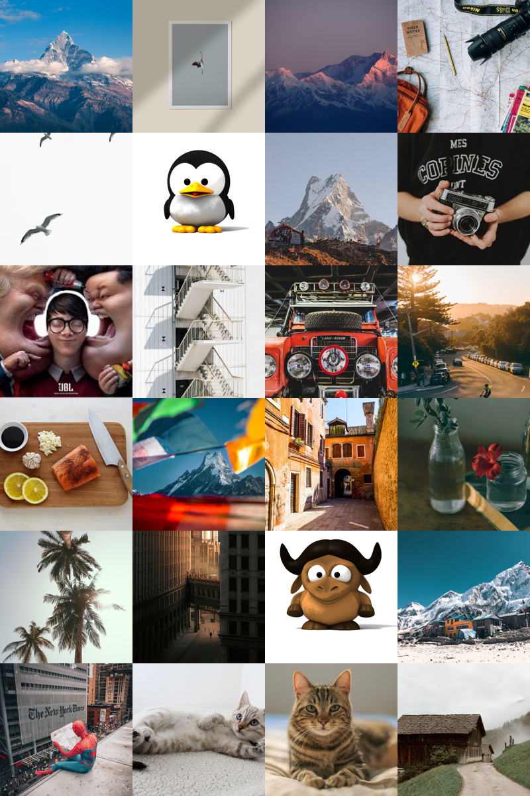
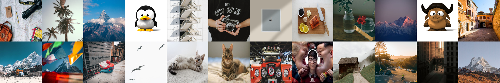
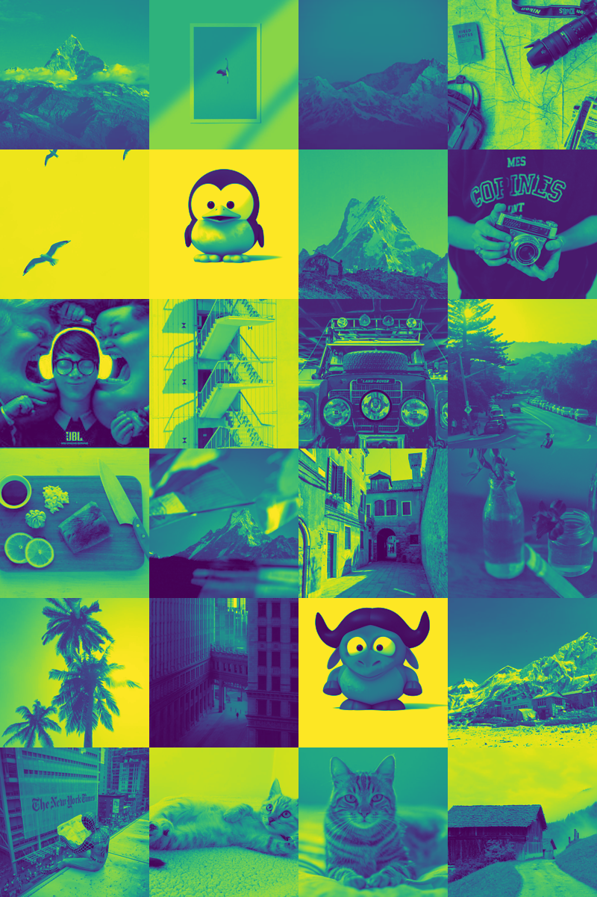

# Create Mosaic of 24 RGB Image and split color channels
Task Description:
1. To create mosaic of 24 RGB images using numpy operations only in user defined shape (e.g. 4x6, 12x2, 3x8)
2. To split mosaic thus created into three different images per color channel

## Description
Mosaic is a collection of images placed in a grid to form a bigger picture. Mostly, they form a pattern or image from smaller images. Here I am trying to create mosaic from given images however will not form any specific pattern.

## Approach
Here the program first read images from a given directory and then resized with `PIL.Image.resize()` to square image. After that I used the following algorithm to `concatenate` horizontally first and then vertically to finally create a mosaic.

### Algorithm

        width = row size
        index = 0
        for j in column:
            perform horizontal stacking
            append to list L
            if (number of images in row = number of column):
                perform vertical stacking of L to Result
            else:
                set index to row size
                set width to row + width
        return Result

To split the result into RGB channels, I tried to use `.split()` however single channel images were shown in  grayscale. So I had an option to create the pixel data for each band by suppressing the bands we don't want [[7]](https://stackoverflow.com/questions/51325224/python-pil-image-split-to-rgb/51555134):

        data = img.getdata()

        # Suppress specific bands (e.g. (255, 120, 65) -> (0, 120, 0) for g)
        r = [(d[0], 0, 0) for d in data]
        g = [(0, d[1], 0) for d in data]
        b = [(0, 0, d[2]) for d in data]

However this was slow operation and hence I used `numpy split operation` to separate the channels.

### Cropping image
Suppose we have images with variation in dimension and we want to form a mosaic without the image being distorted, resizing the image alone will create some distortion. So I also cropped the image implemented in `crop_image()` function.

        Image.crop((left, upper, right, lower))

## Dependencies

        1. numpy
        2. pillow
        3. matplotlib

## Usage

        python src/main.py --dir <image directory> --shape <row> <column> [OPTIONAL]--dim <dimension> --crop <bool>

## Results
### Mosaic of 6x4

### Mosaic of 2x12

### Red channel

### Green channel

### Blue channel

## Futur work
1. May be try grouping the images according to similarity in the average color.

# References
1. https://github.com/f0rk/mosaicify/blob/master/lib/mosaicify/
2. https://pillow.readthedocs.io
3. https://numpy.org/doc/stable/reference/
4. https://numpy.org/doc/stable/reference/generated/numpy.ndarray.resize.html
5. https://gfx.cs.princeton.edu/proj/mosaic/princeton-cs-tr-574-98.pdf
6. https://citeseerx.ist.psu.edu/viewdoc/download?doi=10.1.1.19.7961&rep=rep1&type=pdf
7. https://stackoverflow.com/questions/51325224/python-pil-image-split-to-rgb/51555134
