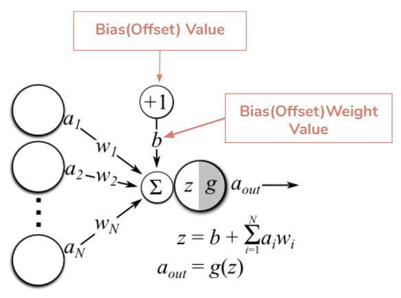
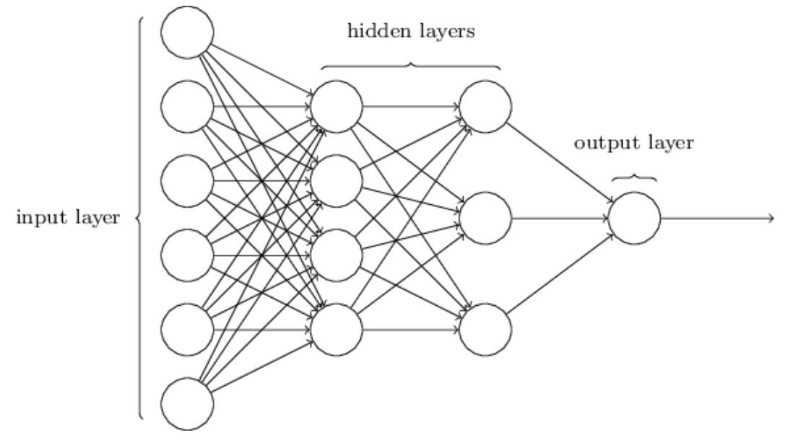
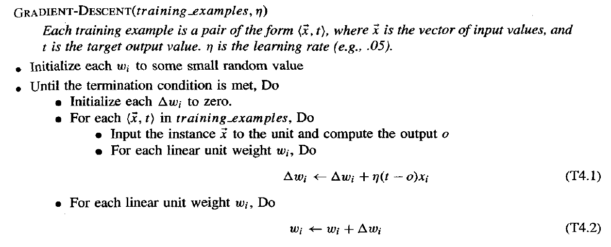

# Neural Network Basics

Task Description:
Study and document basics of Neural Network
1. Artificial Neurons ( Perceptrons, Sigmoids, ... )
2. Weights and Biases
3. Activation Function
4. Forming layers and defining architecture of neural network
5. Feed-forward network
6. Different cost functions
7. Gradient descent algorithm

## Artificial Neural Network

Neural Network learning methods provide a robust approach to approximating real-valued, discrete-valued, and vector-valued target functions. This learning is well-suited for noisy, and complex sensor data.

### Perceptron
A perceptron takes a vector of real valued input, calculates linear combinations and gives 1 if the result is greater than a threshold and -1 otherwise as output. Given $`x_1`$ ... $`x_n`$ as input and $`w_i`$ weight, the output is:

$`o(x_1, ..., x_n) = \begin{cases} 1 & \text{if } w_0 + w_1x_1 + w_2x_2 + ... + w_nx_n \geq 0 \\ 0 & otherwise\end{cases}`$

Here $`-w_0`$ is the threshold that must be suppressed to get 1. Since here sign is only important, we can modify to get:

$$`o(\vec{x}) = sgn(\vec{w}\cdot\vec{x})`$$

#### Representation
Like in SVM, we can view ***the perceptron as representing a hyperplane decision surface in n-dimensional space***. So if the result is 1 for an instance lying on one side of the hyperplane then the result is -1 for the instance lying on the other side.

### Sigmoids
It is much like perceptron but takes any value between 0 and 1 and gives a continuous output accordingly. Small change in weight results in small change in output unlike perceptron which gives 0 or 1.

$$`o = \sigma(\vec{w}\cdot \vec{x})`$$
where,
$$`\sigma(y) = \dfrac{1}{1+e^{-y}}`$$
also called sigmoid function or logistic function.

### Weights and Biases
Weights and biases are applied when transmitting input from one neuron to another. **Weights, w** controls how much influence the input will have on the output. More weight equals more influence. **Biases, b** are constants that are added to the next layer and guarantees that the output of the neuron is b even if all the inputs become 0.

*Image Source: [paperspace](https://docs.paperspace.com/machine-learning/wiki/weights-and-biases)*

### The architecture of Neural Networks

Generally, the neural network has three main layers: input layer, hidden layer and output layer.

*Image source: [neuralnetworksanddeeplearning](http://neuralnetworksanddeeplearning.com/chap1.html#learning_with_gradient_descent)*

For an image of $`8 \times 8`$, we will have $`8 \times 8 = 16`$ input neurons in input layer. And if we are classifying if the number in image is 7 or not, then it will have a single output neuron in output layer. Designing hidden layer depends. Neural networks researchers have developed many design heuristics for the hidden layers, which help people get the behaviour they want out of their nets.

These networks are feed-forward networks as the output of one neuron is used as input to another. Here we do not have any feedback loops. If a network has such feedback, it's called recurrent neural network.
### Perceptron training rule
This is for a single neuron. Here we start with random weight, then iteratively apply the perceptron to each training example, modify the perceptron weight whenever the example is misclassified until the perceptron classifies all examples correctly. This method gives good results for linearly separable data but if the data are not linearly separable, convergence is not assured.

### Gradient Descent and Delta rule
Unlike perceptron training rule, this converges towards the best-fit approximation to the target concept if given data are not linearly separable.

*Source: Machine Learning, Tom Mitchell*

**Cost function**:
Let us specify a measure for training error relative to training example be:

$$`E(\vec{w}) \equiv \dfrac{1}{2}\sum_{d\epsilon D} (t_d - o_d)^2`$$

which is a sum of squared error, where D is the set of training examples, $`t_d`$ is the target output, $`o_d`$ is obtained output.

The gradient of E with respect to $`w`$ is given as:

$$`\triangledown E(\vec{w}) = [\dfrac{\delta E}{\delta w_0}, ..., \dfrac{\delta E}{\delta w_n}]`$$

And the training rule is:

$$`\vec{w} \impliedby \vec{w} + \triangle\vec{w}`$$

where,
$$`\vec{w} = -\eta\triangledown E(\vec{w})`$$

The negative gives the direction of the steepest decrease (of gradient descent), $`\eta`$ is the learning rate which determines the step size.
This in component form looks like:

$$`\triangle w_i = -\eta \dfrac{\delta E}{\delta w_i}`$$

Differentiating $`\triangledown E`$ with respect to $`w_i`$ and simplifying we get,

$$`\triangle w_i = \eta \sum_{t\epsilon D} (t_d - o_d) x_{id}`$$

Some key difficulties in applying gradient descent are: (1) converging to a local minimum can sometimes be quite slow and (2) if there are multiple local minimums, then there is no guarantee that it will reach a global minimum. To overcome these problem we use *Stochastic Gradient Descent*. Here we simply update the weight incrementally to approximate the gradient descent. The modified training rule is like the training rule
given except that as we iterate through each training example we update the weight according to:

$$`\triangle w_i = \eta (t-o)x_i`$$

The key differences between standard gradient descent and stochastic gradient descent are:

1. In standard gradient descent, the error is summed over all examples before
updating weights, whereas stochastic gradient descent weights are updated upon examining each training example.
2. Summing  over multiple examples in standard gradient descent requires more
computation per weight update step. On the other hand, because it uses the
true gradient, standard gradient descent is often used with a larger step size
per weight update than stochastic gradient descent.
3. In cases where there are multiple local minima with respect to $`E(w)`$ , stochastic gradient descent can sometimes avoid falling into these local minima.

# References
1. [Neural Networks and Deep Learning](http://neuralnetworksanddeeplearning.com/chap1.html)
2. Machine Learning, Tom M. Mitchell
3. [Paperspace](https://docs.paperspace.com/machine-learning/wiki/weights-and-biases)
