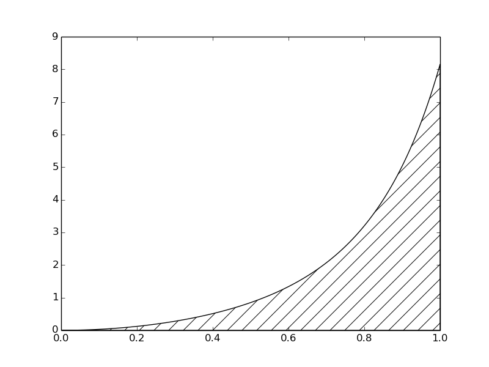
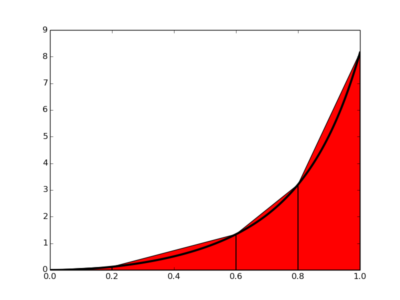
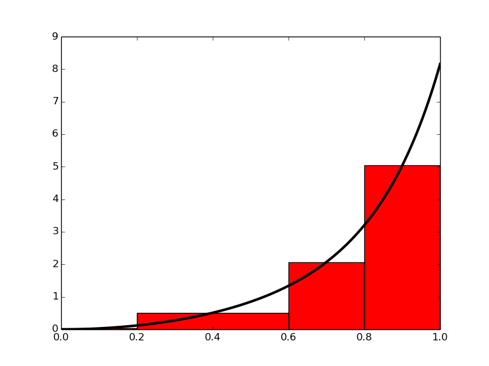

# Numerical Integration
Task Description: Implement numerical integration of a exponential function from scratch (without using any other library to do so)

## Description
Integration can be calculated by,

$`\int_{a}^{b} f(x)dx = F(b) - F(a)`$

where $`f(x) = \dfrac{dF}{dx}`$

To calculate this, we need to calculate the anti-derivative $``F(x)$ which becomes quite challenging. So we use Numerical method that give approximate result. Numerical methos can be used to easily integrate f(x) in samples (discrete values). 

The numerical integration of f(x) can be calculated by splitting the original interval [a, b] into a number of integration points: $`x_i, i = 0, 1, 2..., n`$. These may or may not be uniformaly distributed. For uniformly distributed ones we can compute as,

$`x_i = a + ih`$

where $`h = \dfrac{b - a}{n}`$
So the integration becomes:

$`\int_{a}^{b} f(x)dx = \int_{x_0}^{x_1} f(x)dx + \int_{x_1}^{x_2} f(x)dx + ... + \int_{x_{n-1}}^{x_n} f(x)dx`$

where $`x_0 = a`$ and $`x_n = b`$

 The fundamental idea is that each term is an integral over a small interval $`[x_i,x_{i+1}]`$

## Approach
### 1. Composite Trapezoidal rule

The integral $`\int_a^b f(x)dx`$ may be interpreted as the area between the x axis and the graph y=f(x) of the integrand.

And of we replace true graph with straight line, we get trapeezoids whose area can be calculated easily. Hence, the integral is given by:

$` \int_a^b f(x)dx \approx  h [\dfrac{1}{2}f(x_0) + \sum_{i=1}^{n-1} f(x_i) + \dfrac{1}{2}f(x_n)]`$

where, $`h = \dfrac{b - a}{n}`$ is the width of interval.

### 1. Mid-point mehtod

Here we find the area of rectangles rather than trapeozoids. This mothod although might look like less accurate, is more accurate than the trapezoidal one. 

The general form of this method is:

$`\int_a^b f(x)dx \approx h \sum_{i=0}^{n-1} f(x_i)`$,

where $`x_i = (a + \dfrac{h}{2}) + ih`$. Again $`h = \dfrac{b - a}{n}`$

#### Vectorizing
The fundamental ideas of the vectorized algorithm are to

1. compute all the evaluation points in one array x
2. call f(x) to produce an array of corresponding function values
3. use the sum function to sum the f(x) values

## Dependencies

        1. numpy

## Usage

        python src/main.py

## Results
The program calculates approximate integrals of a function $`f(x) = 3x^2e^{x^3}`$. 

## Resources
1. http://hplgit.github.io/prog4comp/doc/pub/p4c-sphinx-Python/._pylight004.html#basic-ideas-of-numerical-integration