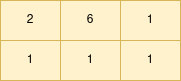
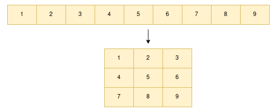
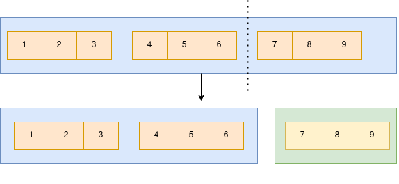
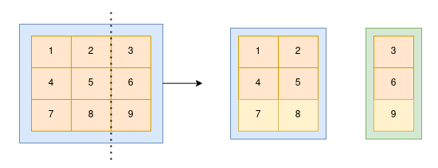

# Numpy Array manipulations
(Attributes, Indexing, Slicing, Reshape, Concatenate and split)

An array is a grid of values which contains information about the raw data, how to locate an element and how to interpret an element. In Numpy, `ndarray`  (N-dimensional array) is an array with any number of dimensions.

## Attributes of array
Suppose we need to get or set the properties of an array without creating a new array, we use attributes of the array. They reflect information intrinsic to the array itself.

Some attributes of array are:

1. ndim: We use `ndim` to get the number of dimensions (axis).

        import numpy as np
        foo = np.random.randint(10, size=(3, 4))
        print(foo)
        >>array([[2, 6, 1],
                [1, 1, 1]])

        foo.ndim
        >> 2
    Here the array foo is 2D.

2. shape: We use `shape` to get the size of each dimension. For a matrix with n rows and m columns, shape will be `(n,m)`

        foo.shape
        >>(2, 3)

3. size: We use `size` to get the size of the array.

        foo.size
        >>6

4. dtype: We use `dtype` to get the data type of values in an array.
   
        foo.dtype
        >>dtype('int64')

5. itemsize: We use `itemsize` to get the size of each array element. For float64, itemsize = 64/8 = 8. For complex32, itemsize = 32/8 = 4 and so on.

        foo.itemsize
        >>8

7. T: We use `T` to get the transpose of the array.

        foo.T
        >>array([[2, 1],
                [6, 1],
                [1, 1]])

8. real and imag: We use `real` and `imag` to get the real and imaginary parts of the array.
   
## Array Indexing
### Accessing single element
It is similar to python list while accessing data in array. For 1D we use array[i] to access $`i^{th}`$ element in array. Similarly, in 2D we use array[i, j] to access element from $`i^{th}`$ row and $`j^{th}`$ column.

    x = np.array([1, 2, 3, 4])
    x[-1]
    >>4

    foo[0]
    >>array([2, 6, 1])

    foo[0,1]
    >>6

    # Assigning
    foo[0, 1] = 7
    foo[0, 1]
    >>7
Here we can also use negative indices to index from the end of the array.
Similarly, we can assign values as well however the assigned value has to be of the same type otherwise NumPy will `silently truncate` if possible.

## Array Slicing

Slicing can be used to access sub-arrays in an array. Importantly, slicing returns `views` not the copy of the array. So changing the sliced array changes the values in the original array. This helps us in manipulating larger arrays.

`array[start:stop:step]`

By default start = 0, stop = size of dimension and step = 1.

    x[:] # all element
    x[:3] # elements from 0 to 2
    x[2:] # elements from 2 to all
    x[::2] # return every other element
    >>array([1, 3])
    x[::-1] # all element reversed
    >>array([4, 3, 2, 1])

Similarly for multi-dimension,

    foo[:2,:3] # two rows, three columns
    foo[:2, :3:2] # two rows, three columns with step size 2
    foo[::-1, ::-1] # reverse multi dim array

Accessing rows and columns

    foo[:, 2] # second column
    foo[0, :] # zeroth row

Instead of `no-copy views` if we want a copy, we can use `.copy()`

## Reshaping of Array
Suppose we have an array and we want to change its shape. Here we have two approaches `numpy.reshape()` and `numpy.newaxis`.

numpy.reshape reshapes the array to the desired layout while numpy.newaxis uses slicing to recreate the array.

    y = np.array([1, 2, 3, 4, 5, 6, 7, 8, 9])
    y.reshape((3,3))
    >>array([[1, 2, 3],
       [4, 5, 6],
       [7, 8, 9]])

`numpy.newaxis` is just an alias for the Python constant `None`, which means that wherever you use np.newaxis you could also use None. It indicates that you want to add an `additional dimension` to the array. The position of the numpy.newaxis represents where we want to add dimensions.

Here are some use case scenarios of new axis straight from [here](https://stackoverflow.com/questions/29241056/how-does-numpy-newaxis-work-and-when-to-use-it):

1. Scenario 1: explicitly convert 1D array to row or column vector.

        # 1D array
        arr = np.arange(4)
        arr.shape
        >>(4,)

        # make it as row vector by inserting an axis along first dimension
        row_vec = arr[np.newaxis, :]     # arr[None, :]
        row_vec.shape
        >>(1, 4)

        # make it as column vector by inserting an axis along second dimension
        col_vec = arr[:, np.newaxis]     # arr[:, None]
        col_vec.shape
        >>(4, 1)
    
2. Senario 2: While using numpy broadcasting

        x1 = np.array([1, 2, 3, 4, 5])
        x2 = np.array([5, 4, 3])

We cannot add x1 and x2 due to difference in shape so we use np.newaxis to increase the dimension of one of the arrays so that NumPy can broadcast.

        In [2]: x1_new = x1[:, np.newaxis]    # x1[:, None]
        # now, the shape of x1_new is (5, 1)
        # array([[1],
        #        [2],
        #        [3],
        #        [4],
        #        [5]])

Now add:

        In [3]: x1_new + x2
        Out[3]:
        array([[ 6,  5,  4],
        [ 7,  6,  5],
        [ 8,  7,  6],
        [ 9,  8,  7],
        [10,  9,  8]])
3. Senario 3: Adding multiple dimensions
   
        arr_5D = arr[np.newaxis, .. , np.newaxis, np.newaxis]

        arr_5D.shape
        >>(1, 5, 5, 1, 1)

## Array concatenation and Splitting

We can concatenate multiple arrays into one and also split one into multiple arrays.

### Concatenate
In order to join two or more arrays we use `np.concatenate` and pass tuple or list of arrays as arguments:

        np.concatenate([x1, x2])
        >> array([1, 2, 3, 4, 5, 5, 4, 3])
        np.concatenate([x2, x1])
        >> array([5, 4, 3, 1, 2, 3, 4, 5])

Sometimes we might have to concatenate vertically and other times horizontally, for this we can pass `axis` parameter(1 --> horizontal and 0 --> vertical) in np.concatenate or use `np.vstack` and `np.hstack`:

        x = np.array([[1, 2, 3], [4, 5, 6]])
        np.concatenate([x, x])
        >> array([[1, 2, 3],
                [4, 5, 6],
                [1, 2, 3],
                [4, 5, 6]])

        np.concatenate([x, x], axis = 1)
        >>array([[1, 2, 3, 1, 2, 3],
                [4, 5, 6, 4, 5, 6]])

        np.vstack([x,x])
        >> array([[1, 2, 3],
                [4, 5, 6],
                [1, 2, 3],
                [4, 5, 6]])
        np.hstack([x, x])
        >> array([[1, 2, 3, 1, 2, 3],
                [4, 5, 6, 4, 5, 6]])

### Splitting
To split an array, we use `np.split`, `np.hsplit` and `np.vsplit`. Here we pass a list of indices giving the split points.

        y = np.array([1, 2, 3, 4, 5, 6, 7])
        np.split(y, [3, 5])
        >> [array([1, 2, 3]), array([4, 5]), array([6, 7])]

1. Vertical split(Row-wise): To split an array in multiple sub-arrays vertically (row-wise).

        x = np.arange(16.0).reshape(4, 4)

        x
        array([[ 0.,   1.,   2.,   3.],
        [ 4.,   5.,   6.,   7.],
        [ 8.,   9.,  10.,  11.],
        [12.,  13.,  14.,  15.]])

        # To split array into n equal arrays
        # np.vsplit(x, n)
        np.vsplit(x, 2)
        [array([[0., 1., 2., 3.],
        [4., 5., 6., 7.]]), array([[ 8.,  9., 10., 11.],
        [12., 13., 14., 15.]])]

        # To split array with indexing
        np.vsplit(x, np.array([3, 6]))
        [array([[ 0.,  1.,  2.,  3.],
        [ 4.,  5.,  6.,  7.],
        [ 8.,  9., 10., 11.]]), array([[12., 13., 14., 15.]]), array([], shape=(0, 4), dtype=float64)]

2. Horizontal split(Column-wise):
Split an array into multiple sub-arrays horizontally (column-wise).

        # To split in n equal arrays
        np.hsplit(x, 2)
        [array([[  0.,   1.],
        [  4.,   5.],
        [  8.,   9.],
        [12.,  13.]]),
        array([[  2.,   3.],
        [  6.,   7.],
        [10.,  11.],
        [14.,  15.]])]

        # To split at particular index
        np.hsplit(x, np.array([3, 6]))
        [array([[ 0.,   1.,   2.],
        [ 4.,   5.,   6.],
        [ 8.,   9.,  10.],
        [12.,  13.,  14.]]),
        array([[ 3.],
        [ 7.],
        [11.],
        [15.]]),
        array([], shape=(4, 0), dtype=float64)]

## References
1. [Numpy Documentations](https://numpy.org/doc/)
2. Python Data Science Handbook
3. [np.newaxis](https://stackoverflow.com/questions/29241056/how-does-numpy-newaxis-work-and-when-to-use-it)

