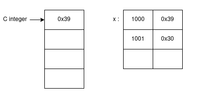
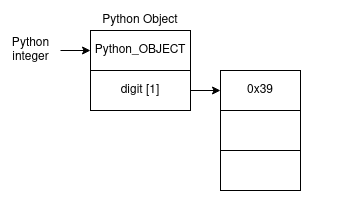
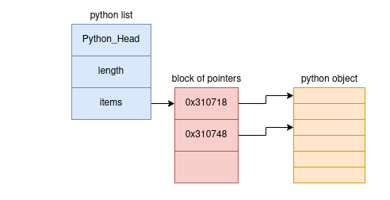
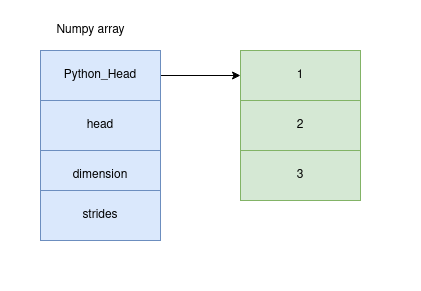

# Numpy Basics

## Integers in C/C++ and Python
- Integer in C is a label given to a `location in memory` where values are stored. For example: 
  $`int x = 12345;`$

    

- Although implemented in C, Python integer have extra information so is `less efficient` yet comes with greater `flexibility`. Every python object is a C structure with `values`, `reference count`, `type`, and `size`. So it works fine even with not mentioning data types explicitly like in C/C++. For example: x = 12345, x = 123.45

    

- Python integer is a pointer to memory position that contains all the information about the python object and not the values itself. And the python object.

## Lists in python and Numpy
- Python list just extends the `flexibility` of to another level. It is a standard mutable multielement container which means we can have bool, int, float and other data in the same list. For example: 

        myList = [0.1, True, 11, 'abc']
- Here each item in list must contain it's own python object so what happens is the list contains a pointer to a block of pointers each of which again points to full python object. We see that there are alot of overhead on going from one block to another and then to another.
    

    

- Numpy Aray is same as python list but with same data type. This makes it efficient to store and manipulating data. What the numpy array has is single pointer to one contiguous block of data and thus terminating the overhead that python list had.

In conclusion, Numpy Array is much more efficient in storing and manipulating data compared to python in-built types.

## Creating Numpy Array

Numpy array can be created in two ways:
#### Python list: 
Suppose we have a list in python, here we just pass the list to the numpy function np.array(). Also since the data type should be same in numpy array, even if we pass list with different datatype, it is automatically converted. 

For example:

    `np.array([1, 2, 3, 4, 5], dtype ='int')`
    ==> array(1, 2, 3, 4, 5)
    `np.array([1.0, 1, 2, 5], dtype='float32')`
    ==> array( 1.0, 1.0, 2.0, 5.0)

#### Scratch approach:
It is not convenient to create a large array from python list if we do not have it in-hand. So we have this approach. 

- np.zeros: Suppose we have to create an array filled with 0's of length x, we have: 
  
    `np.zeros(x, dtype=int)`
- np.ones: Similarly, to create an array filled with 1's of `n x m` size, we have: `np.ones((n, m), dtype=float)`
- np.full: Similarly, to create an array filled with value `x` of `n x m` size, we have: `np.full((n, m), x)`
- np.arange: Similarly, to create an array filled with a linear sequence, we have: `np.arange(start, end, step)`
- np.linspace: Now if we want an evenly spaced array:`np.linspace(start, end, step)`
- random: To create random variabled array with normal distribution in between x and y we can use `np.random.normal(mean, std, (x, y))` and for uniform distribution we can use   `np.random.random((x, y))`
- randint: To create random integer we use `np.random.randint(mean, std, (x,y))`
- identity matrix: To create identity matrix of `n x n`: `np.eye(n)`
- empty matrix: To create empty matrix of `n x n`: `np.empty(n)`

## Numpy Standard data types
Some of the standard dataypes of Numpy are as follows:

|Data type | Description|
|------    | ------     |
|`bool_`   |True or False boolean type|
|`int_`    |default integer; same as long in C|
|`intc`    |normally int32 or int64; same as int in C|
|`intp`    |Integer for indexing|
|`int8`    |Byte (-128 to 127)|
|`int16`   |Integer (-32768 to 32767)|
|`int32`   |Integer (–2147483648 to 2147483647)|
|`int64`   |Integer (–9223372036854775808 to 9223372036854775807)|
|`uint8`   |Unsigned integer (0 to 255)|
|`uint16`  |Unsigned integer (0 to 65535)|
|`uint32`  |Unsigned integer (0 to 4294967295)|
|`uint64`  |Unsigned integer (0 to 18446744073709551615)|
|`float_`  |Shorthand for float64|
|`float16` |Half-precision float|
|`float32` |Single-precision float|
|`float64` |Double-precision float|
|`complex_`|Shorthand for complex128|
|`complex64`|Complex number, represented by two 32-bit floats|
|`complex128`|Complex number, represented by two 64-bit floats|

Type of array can be converted using `.astype()` as:

        >>arr.astype(float)
        array([1., 2.])
