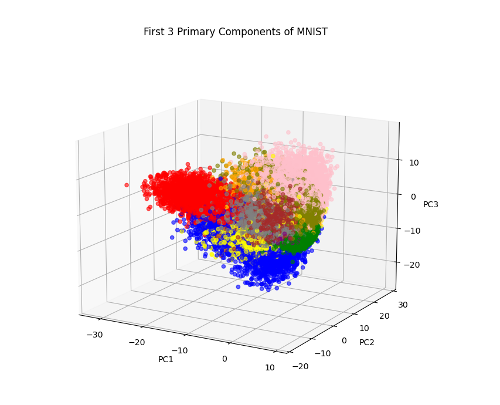

# PCA

Task Descriotion: Implement PCA and apply it for dimensinionaly reduction of mnist dataset to 3 Dimension (and visualize the result)


## Dependencies
```
    1. numpy
    2. mlxtend
    3. matplotlib
    4. tqdm
```
## Usage

        $ python src/main.py 

## Results

# References
1. https://github.com/numpy/numpy/blob/v1.8.0/numpy/lib/function_base.py#L1648
