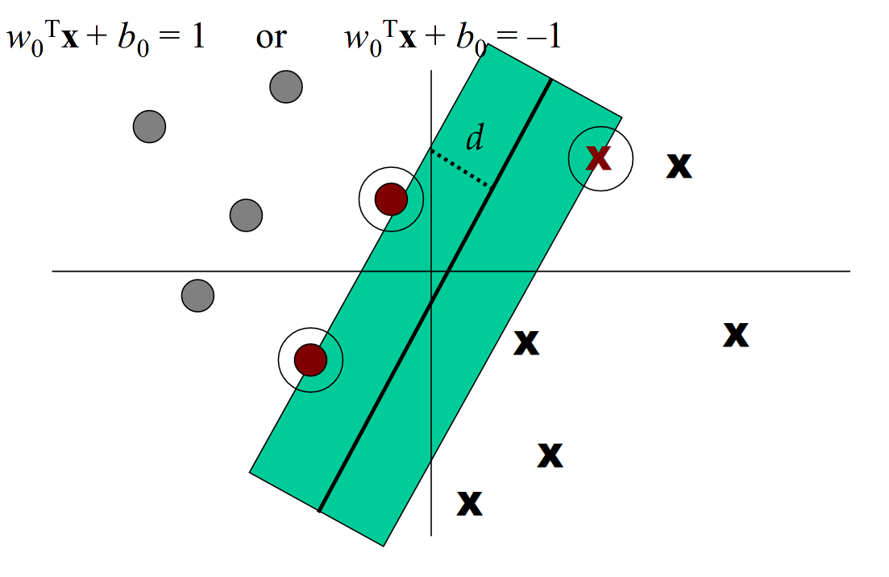
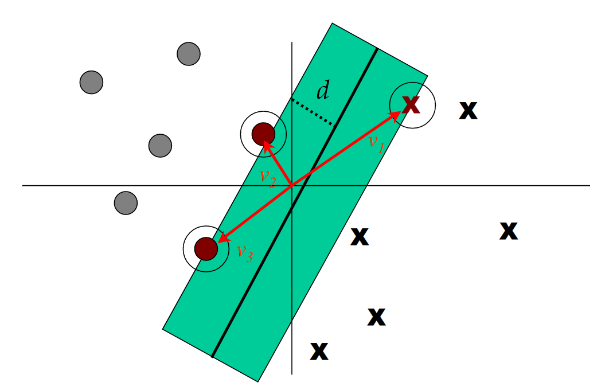
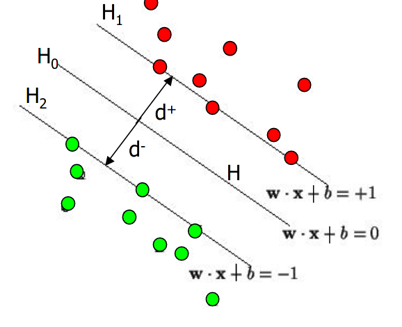
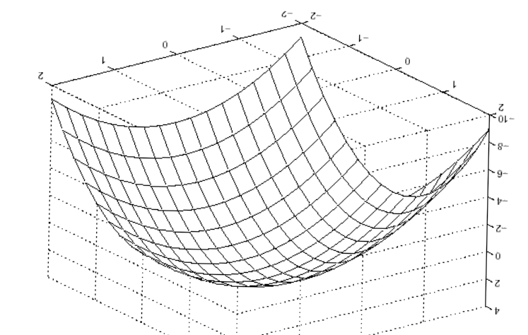
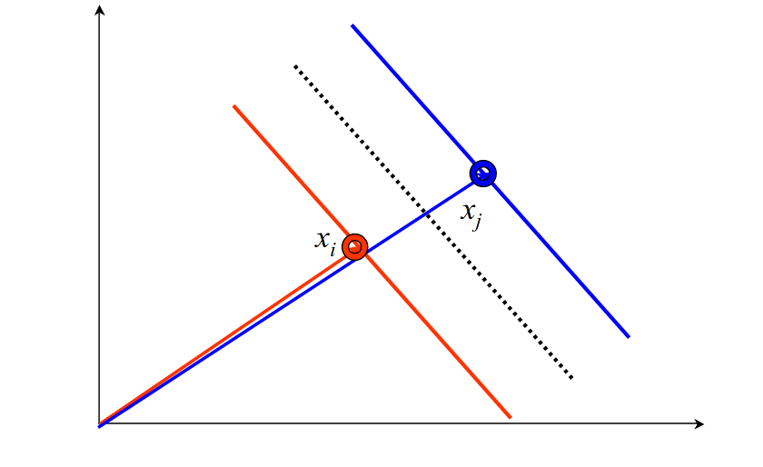
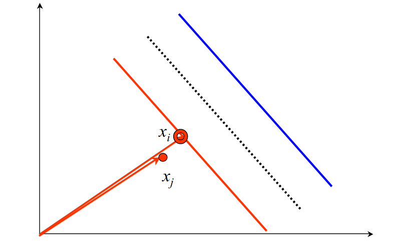
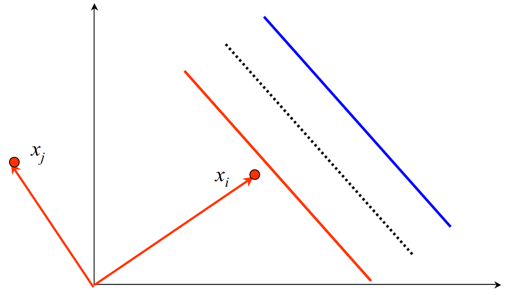
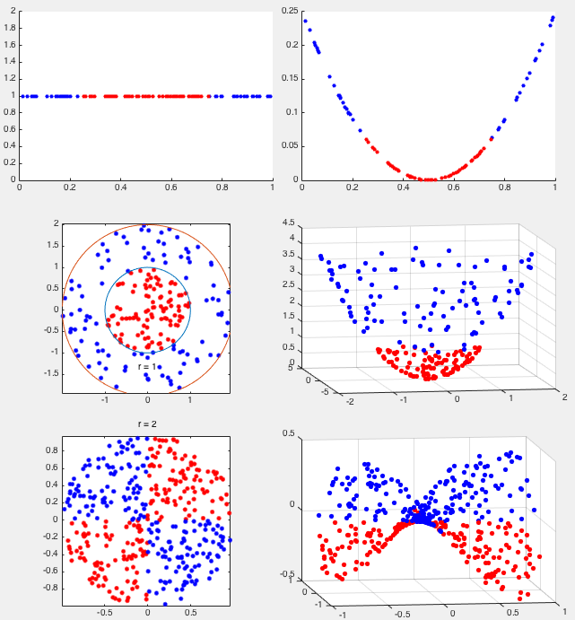
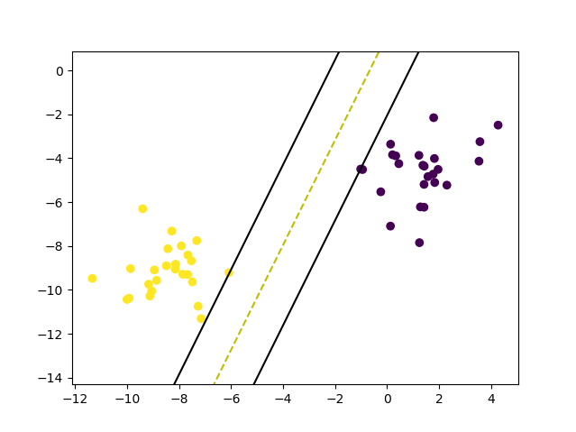
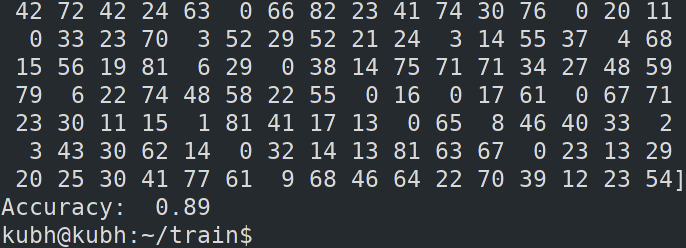

# Support Vector Machine

Task Description:
    1. Study in detail about Support Vector Machines(SVM).
    2. Use SVM for Ekbana face-check in dataset and create a classifier for AI team's face.

## Approach

- Implement simple linear SVM in *svm_simple.py*.
- Then studied more on SVM and SMO algorithms.
- Since original SMO had some complex heuristics, I  implemented Simplified SMO as explained in [Stanford lecture note](http://cs229.stanford.edu/materials/smo.pdf) and [hmc.edu](http://fourier.eng.hmc.edu/e176/lectures/ch9/node9.html).
- This was still a binary classifier but as our given dataset had multi-class label, finally I implemented **one-against-one** method for multi-class SVM classifier as explained [here](https://www.syncfusion.com/ebooks/support_vector_machines_succinctly/multi-class-svms).

## Description
Core concept of SVM is to find an optimal hyperplane that classifies given data. If the data are not linearly separable, we extend patterns by transforming the original data to map to new space - *the Kernel function*

## Support Vectors
- Support vectors are the data points that lie closest to the decision surface (or hyperplane).
- Critical element that changes the position of dividing hyperplanes if removed.

## Support Vector Machine
- SVMs maximize the margin(*the street*) around the separating hyperplane.
- Similar to neural net with slight difference: it uses optimization of maximizing the margin to reduce the number of *nonzero weights*, support vectors (the important features that matter in deciding the separating hyperplane).

### Support Vectors for linearly separable cases
Since we are finding the optimal hyperplane and it is an optimization problem, we can use the Lagrange multiplier (optimization technique).

Here $`H_1`$ and $`H_2`$ are the planes passing through the tip of support vectors and $`H_0`$ is the dividing hyperplane that is d distance from $`H_1`$ and $`H_2`$. Our hyperplane is such that:

$`w\cdot x_i + b \geq +1 if y_i = +1`$

$`w\cdot x_i + b \leq +1 if y_i = -1`$

To maximize the margin we first find the distance between $`H_0`$ and $`H_1`$ d,

$`\dfrac{|w\cdot x + b|}{||w||}  = \dfrac{1}{||w||}`$

So the total distance is: $`\dfrac{2}{||w||}`$

Maximizing the margin $`\implies`$ minimizing $`||w||`$. So we need to solve the quadratic programming problem which is:

min $`||w||`$ s.t. discriminant boundary is obeyed. This can be rewritten as:

min $`f: \dfrac{1}{2} ||w||^2`$ s.t.

$`g: y_i(w\cdot x_i - b = 1)`$  

As the problem is quadratic, the surface is paraboloid with a single global minimum.

Here we find the intersection of two functions $`f, g`$ at the tangent where derivative is zero.

The Lagrangian form of our problem is:

$`min L = f(x) + \sum_i a_ig_i(x)`$

$`min L = \dfrac{1}{2} ||w||^2; g(x): y_i(w\cdot x_i + b) - 1 = 0`$

$`min L_p = \dfrac{1}{2} ||w||^2 - \sum_{i=1}^l  a_iy_i(w\cdot x_i + b) + \sum_{i=1}^l a_i  `$  
s.t. $`\forall i, a_i \geq 0`$ where $`l`$ is the number of training points

As derivative at min = 0, we get:

$`\dfrac{\partial L_p}{\partial w} = w - \sum a_iy_ix_i = 0`$

$`\dfrac{\partial L_p}{\partial w} = w - \sum a_iy_i = 0`$

so,

$`w = \sum a_iy_ix_i, \sum a_iy_i =0`$

The dual of this problem is:

$`max L_D(a_i) = \sum a_i - \dfrac{1}{2} \sum a_ia_jy_iy_j(x_i\cdot x_j)`$

s.t. $`\sum a_iy_i = 0`$ and $`a_i \geq 0`$

#### Inner product kernel
- Here we are looking for similar vectors that give different classes (one gives +1 and another gives -1). This tends to maximize the margin.

  
- Two vectors that are similar but predict the same class are redundant

  
- we do not consider dissimilar (orthogonal) vectors

### SVM for non-linearly separable

If we directly apply SVM to non-linearly separable data, many data can be misclassified. So an easy fix is to use the transformation. We basically transform the data to another dimension(usually higher).

Applying transformation gives us:

$`max L_D(a_i) = \sum a_i - \dfrac{1}{2} \sum a_ia_jy_iy_j(\phi(x_i)\cdot \phi(x_j))`$

s.t. $`\sum a_iy_i = 0`$ and $`a_i \geq 0`$

But it is known that $`\phi(x_i)\cdot \phi(x_j)`$ calculation is quite expensive so here we use Kernel Trick. It is nothing but an inner product. If $`x_m`$ and $`x_n`$ are inputs then our kernel function is:

$`K = \phi(x_i)^T\cdot \phi(x_j)`$

Kernel function used with this task are:

1. Linear kernel
   
   $`K = X^T\cdot x`$
2. Radial basis function (RBF)

    $`K = e^{- \dfrac{\|\|X- x\|\|^2}{2\sigma^2} }`$
    
    here $`\sigma`$ can be adjusted to fit each specific dataset.

## Dependencies

        1. numpy
        2. sklearn.model_selection
        3. random
        4. tqdm
   
## Usage

        python src/simplified_SMO.py

## Result

Result of simple SVM for randomly generated classes:

Result of Simplified SMO:

## Conclusion

Although this program takes more time to train large data compared to SVC in sklearn, the accuracy obtained is almost similar. So there are lots of optimizations we can do to improve the performance. With this I got a decent understanding on Support vectors, SVM, how it can be used to classify, SMO, Kernel function, and multi-class classifier.

## Future work

Look into SVM implemented in C as done [here](https://www.cs.mcgill.ca/~hv/publications/99.04.McGill.thesis.gmak.pdf).

# References
1. [An Idiot’s guide to Support vectormachines](http://web.mit.edu/6.034/wwwbob/svm.pdf)
2. [The Simplified SMO Algorithm (Standford)](http://cs229.stanford.edu/materials/smo.pdf)
3. [Support vector nicely explained with SMO pseudo-code](http://fourier.eng.hmc.edu/e176/lectures/ch9/node5.html)
4. [SVM lecture video (MIT)](https://www.youtube.com/watch?v=_PwhiWxHK8o)
5. [Simple SVM](https://github.com/eriklindernoren/ML-From-Scratch/blob/master/mlfromscratch/supervised_learning/support_vector_machine.py)
6. [SVM (NEC Labs America)](http://www1.cs.columbia.edu/~kathy/cs4701/documents/jason_svm_tutorial.pdf)
7. [Pretty good implementation of SMO](https://github.com/LasseRegin/SVM-w-SMO/blob/master/SVM.py)
8. [Rudimentary version of the sequential minimal optimization algorithm](https://jonchar.net/notebooks/SVM/)
9. [codeproject](https://www.codeproject.com/Articles/1267445/An-Introduction-to-Support-Vector-Machine-SVM-and)
10. [SVM SMO series of Python implementation](https://programmersought.com/article/62092635547/)
11. [SVM](https://blog.csdn.net/zouxy09/article/details/17292011)
12. [SVM-SMO algorithm](https://programmersought.com/article/29854646102/)
