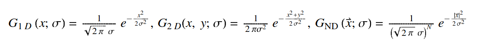
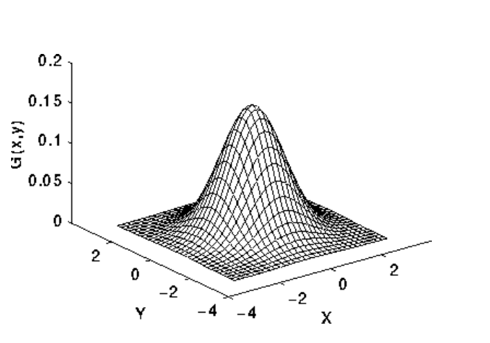
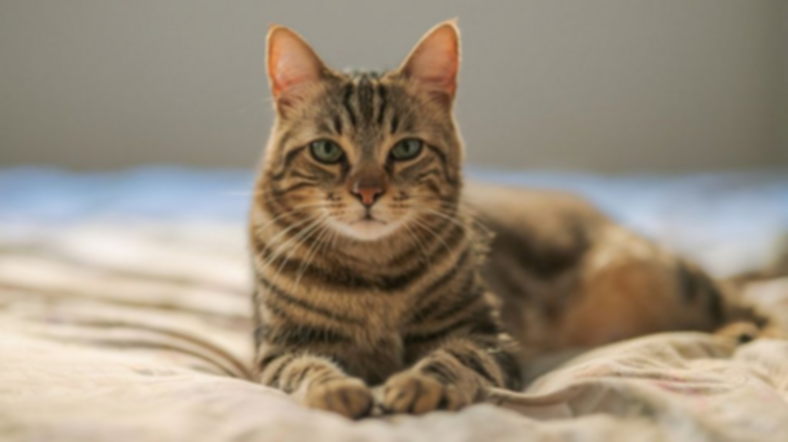

# Split, Apply Gaussian Kernel and Merge

Task Description:
1. Create three [gaussian kernels] matrices(5x5) from gaussian distributions with 0 mean but varying standard deviations.
2. Apply the three different kernels on three color channels of an image.
3. Merge the three results to form a single image.

## Description
`Gaussian Kernel` is a matrix having Gaussian Distribution. The Gaussian distribution in 1-D,2-D and N-D has the form:

where $`\sigma`$ is the `standard deviation` of distribution. Here we also assume that the distribution has `mean zero`.

Fig: Gaussian distribution with mean (0,0) and $`\sigma`$=1

I have discussed in detail about Gaussian Filter on previous post [here](https://repo.ekbana.info/LearnMLBatchAugust2020/DLComputerVision/anil-shrestha/tree/master/GaussianBlur)

## Approach

The program first read the image using `PIL`. Then it is split into three channels `r,g,b`. Then we create a Gaussian kernel with size 5x5 and different sigma implemented in `get_gaussian_kernel()` function. After this, convolution is performed:
1. Using scipy convolution function  
2. From scratch

Finally, the convolved images are merged to give a single image.

### Algorithms

        pad given image
        step = kernel.shape[0]
        for x in range(image col):
            for y in range(image row):
                output[y, x] = sum( kernel * pad_image[y: y+step, x: x+step])

## Dependencies
      1. numpy
      2. pillow
      3. scipy

## Usage
        python src/main.py --image <image directory>

## Results

### Original image

### Colvolving using Scipy

### Convolving using scratch

# References
1. https://homepages.inf.ed.ac.uk/rbf/HIPR2/gsmooth.htm
2. http://pages.stat.wisc.edu/~mchung/teaching/MIA/reading/diffusion.gaussian.kernel.pdf.pdf
3. https://www.mathworks.com/help/images/ref/fspecial.html#bqkft1d
4. https://github.com/ashushekar/image-convolution-from-scratch
5. https://stackoverflow.com/questions/44090179/numpy-ndarray-object-has-no-attribute-mode

