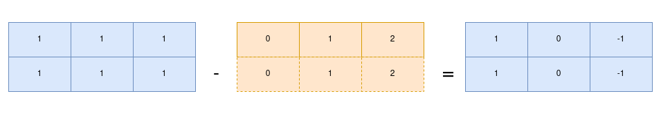

# Subtracting 1D from 2D array

Task Description: Subtract a 1D array from the 2D array, such that each item of 1D array subtracts from respective row of 2D-array
 
To subtract 1D array form 2D array(in general all computations), we first need to understand how computations are done in numpy. 

### Computations in Numpy

Let's first see how we can subtract in Python: loop over the array and then subtract. What happens here is on every operation, Python first examines the `object's type` and does a `dynamic lookup` of the corrent function to use for that type. This takes extra time and affects performance as the size of array increases. Instead of this, if we work on `compiled code`, type specification would be known before the code executes and the result could be computed much more efficiently.

Numpy uses `vectorized` approach that performs loop in compiled layer resulting in faster execution. 

For array of same size, binary operations are performed on element-by-element basis:
        
        x = np.array([1, 1, 1])
        y = np.array([0, 1, 2])
        x - y
        >> array([1, 0, -1])

#### Broadcasting
Suppose we have two different sized arrays: 
        
        x = np.array([[1, 1, 1], [1, 1, 1]]) 
        y = array([0, 1, 2])

`Broadcasting` allows us to perform these binary operations on different sized arrays. We can think of this operation as duplicating the 1D array to match 2D array. 

This can also be achieved with `np.newaxis` which basically adds adds a dimension to the array. Which I have included that as well in the program.

### Rules of broadcasting
1. Add padding to the array with fewer dimension on the left side
2. If still the dimensions does not match, strech the array to match other shape
3. If no dimension is equal to 1, error.
   
Size of array 1 | Size of array 2 | Remarks
---|---|---
(2, 10)|(10,)|
(2, 10)|(1,10)| Padding left
(2, 10)|(2, 10)| Scale

When it might not work?

Size of array 1 | Size of array 2 | Remarks
---|---|---
(3, 2)|(3,)|
(3, 2)|(1,3)| Padding left
(3, 2)|(3, 3)| Scale

